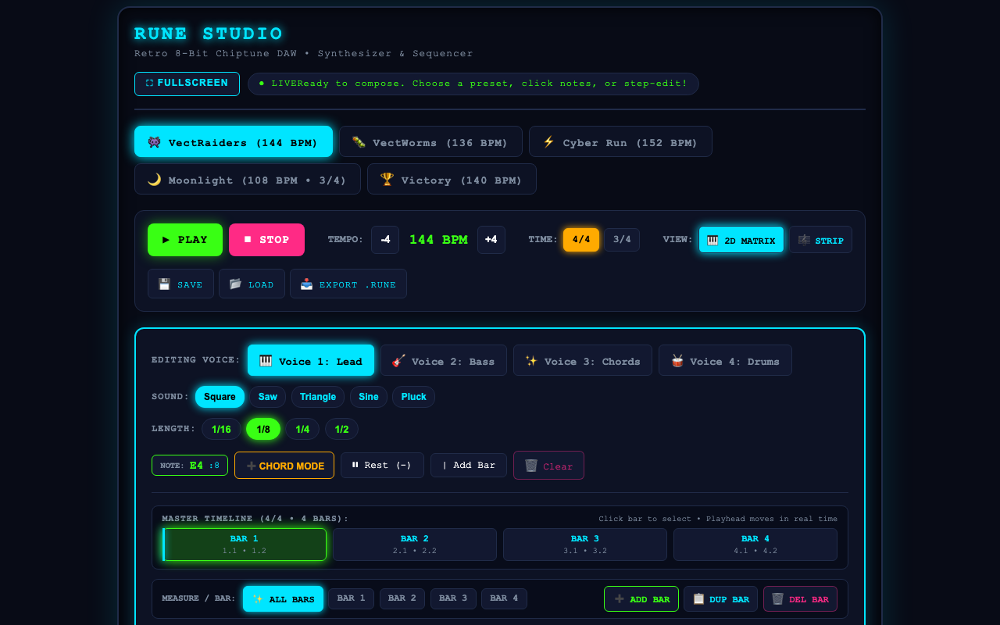
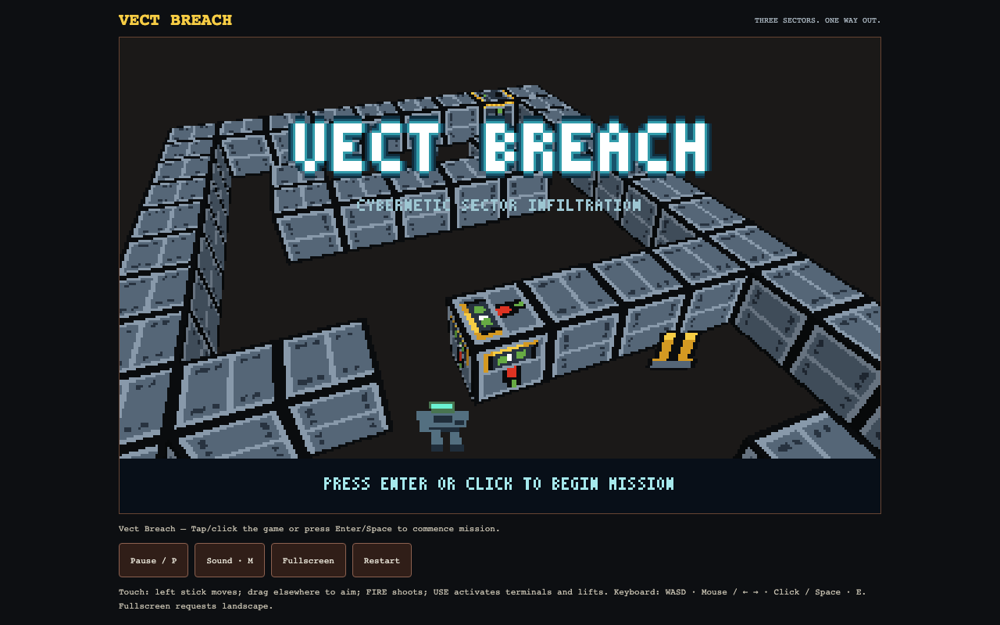

<p align="center">
  
</p>

<h1 align="center">Vectrune</h1>

<p align="center">
  <strong>Structured data in motion.</strong><br>
  A declarative language and runtime for APIs, reactive interfaces, data workflows, and pixel games.
</p>

<p align="center">
  <a href="https://vectrune.com/">Website</a> ·
  <a href="https://vectrune.com/docs/">Language &amp; API reference</a> ·
  <a href="https://vectrune.com/docs/getting-started/">Quickstart</a> ·
  <a href="https://github.com/davethomas11/vectrune/releases/latest">Downloads</a>
</p>

<p align="center">
  <a href="https://github.com/davethomas11/vectrune/actions/workflows/developer-cli.yml"></a>
  <a href="https://github.com/davethomas11/vectrune/releases/latest"></a>
  <a href="https://vectrune.com/docs/coverage/"></a>
</p>

Write routes, schemas, state, views, and game logic in readable `.rune` files. Run them with the `vectrune` CLI, inspect the output, and grow a small example into a multi-file application.

Vectrune combines a Rust runtime with Rune-Web's JavaScript runtime for interactive interfaces and game logic. Start with a REST API, explore a live app, or look up a function in the [searchable reference](https://vectrune.com/docs/).

> **Alpha:** Syntax and runtime behavior are evolving. Some examples on `main` use features newer than the latest release; build from source when working with those examples.

**On this page:** [Quickstart](#quickstart) · [Capabilities](#what-you-can-build) · [Live apps](#built-with-vectrune) · [Examples](#example-library) · [Testing](#test-what-you-build) · [Installation](#installation-options) · [Contributing](#contributing)

## Quickstart

### 1. Install the CLI

On macOS or Linux with Homebrew:

```sh
brew tap davethomas11/homebrew-vectrune
brew install vectrune
vectrune --version
```

Windows and other platforms: use a [release download](https://github.com/davethomas11/vectrune/releases/latest) or [build from source](#build-from-source).

### 2. Create `app.rune`

This complete API includes a health check, a URL parameter, JSON validation, and generated Swagger documentation:

```rune
#!RUNE

@App
name = Greeting API
type = REST
port = 3000
swagger = true

@Schema/Greeting
name = string
enthusiastic = bool

@Route/GET /health
description = Check that the API is running
run:
    respond 200 "OK"

@Route/GET /greetings/{name}
description = Read a name from the URL
run:
    result = { name: name }
    respond 200 result

@Route/POST /greetings
description = Validate and echo a greeting
expect = Greeting
run:
    parse-json
    validate body #Greeting
    respond 201 body
```

[Download this exact example](https://vectrune.com/assets/content/docs/app.rune).

### 3. Run it

```sh
vectrune app.rune
```

In another terminal:

```sh
curl http://127.0.0.1:3000/health
# OK

curl http://127.0.0.1:3000/greetings/Ada
# {"name":"Ada"}

curl -i http://127.0.0.1:3000/greetings -H 'Content-Type: application/json' -d '{"name":"Ada","enthusiastic":true}'
# HTTP 201, with the submitted object in the body
```

Omit `enthusiastic` and the POST returns HTTP 400. Open **http://127.0.0.1:3000/swagger-ui** for interactive API documentation, or inspect **http://127.0.0.1:3000/openapi.json**.

If port 3000 is occupied, use `vectrune app.rune --port 8080` and update the request URLs. In Windows PowerShell, use `curl.exe` to call curl directly.

Continue with the [REST tutorial](https://vectrune.com/docs/getting-started/), [routing reference](https://vectrune.com/docs/rest/), or [validation reference](https://vectrune.com/docs/validation/).

## What you can build

| Area | Implemented capabilities | Explore |
| --- | --- | --- |
| **HTTP APIs** | REST routes, schemas, validation, path parameters, generated OpenAPI, and GraphQL resolvers | [API guides](https://vectrune.com/docs/getting-started/) |
| **Reactive interfaces** | Rune-Web pages, reusable components, state, actions, forms, styles, and localization | [Rune-Web guide](knowledge/language/rune-web-guide.md) |
| **Real-time apps** | WebSocket connections, message handlers, events, and broadcasts | [WebSocket example](https://vectrune.com/docs/websockets/) |
| **Data workflows** | Structured documents, CSV/JSON I/O, grouped reports, format conversion, transforms, and merges | [Native functions](https://vectrune.com/docs/library/native/) |
| **Games and audio** | Pixel sprites, 3D environments, maps, models, portable input, synthesized sound, and chiptune music | [Game reference](https://vectrune.com/docs/library/games/) |
| **Generated sites** | Descriptive pages and JSON endpoints using Ollama or authenticated Codex/Copilot CLIs | [Dynamic AI sites](knowledge/language/dynamic-ai-web.md) |
| **Deployment** | Static HTML exports and AWS Lambda/SAM tooling | [CLI reference](https://vectrune.com/docs/library/cli/) |

Native server functions and frontend commands have distinct runtimes. Reference entries identify availability, arguments, return values, and current limitations.

## Built with Vectrune

Explore the running apps, then read the Rune source behind them.

<table>
  <tr>
    <td width="50%"><a href="https://vectrune.com/studio/"></a></td>
    <td width="50%"><a href="https://vectrune.com/vect-breach/"></a></td>
  </tr>
  <tr>
    <td><strong>Rune Studio</strong> — compose, edit, play, save, and export chiptune music.<br><a href="https://vectrune.com/studio/">Open the app</a> · <a href="examples/rune_studio/">Read the source</a></td>
    <td><strong>Vect Breach</strong> — a first-person pixel game with maps, enemies, controls, sound, and cinematic cameras.<br><a href="https://vectrune.com/vect-breach/">Play</a> · <a href="examples/vect_breach/">Read the source</a></td>
  </tr>
</table>

| App | What it demonstrates | Try it | Source |
| --- | --- | --- | --- |
| **Starfall Protocol** | A space metroidvania with connected sectors, linked abilities, four bosses and cinematic flight sequences | [Play](https://vectrune.com/starfall/) | [Rune source](examples/starfall/) |
| **Rune Crypt** | A dungeon roguelite with block models, combat, equipment, and exploration | [Play](https://vectrune.com/rune-crypt/) | [Rune source](examples/rune_crypt/) |
| **Monster City** | A 2D kaiju game with destructible buildings, a shop, saved progress, and synthesized audio | [Play](https://vectrune.com/monster-city/) | [Rune source](examples/monster_city/) |
| **VectRaiders** | An arcade game with reactive game state, collisions, input, and sound | [Play](https://vectrune.com/games/) | [Rune source](examples/space_invaders/) |
| **Skybound 2** | A lantern-moth adventure across seven sky worlds, with squashable creatures, two bosses, and an original score | [Play](https://vectrune.com/skybound-2/) | [Rune source](examples/skybound_2/) |
| **Learning site** | The site's own components, navigation, localization, and example explorer | [Visit](https://vectrune.com/) | [Site source](teaching_website/) |

The [Rune Miners experiment](examples/rune_miners/) explores seeded voxel worlds, mining, inventory, and shared browser/native game logic on `main`. Authored worlds can use [sparse terrain chunks](knowledge/runtime/voxel-worlds.md) up to 4,096 tiles wide, while shared nearby-entity queries let real-time games sleep distant actors.

## Example library

From a repository checkout, run an example with `vectrune <path>`:

| Start here | Example | What to look for |
| --- | --- | --- |
| Minimal API | [`examples/app.rune`](examples/app.rune) | `@App`, `@Route`, and explicit responses |
| Validated requests | [`teaching_website/content/docs/app.rune`](teaching_website/content/docs/app.rune) | The complete quickstart above, with [five request tests](teaching_website/content/docs/api.test.rune) |
| File-backed API | [`examples/user_api.rune`](examples/user_api.rune) | CSV reads/writes, schemas, and CRUD-style routes |
| GraphQL | [`examples/book_graphql.rune`](examples/book_graphql.rune) | Queries, mutations, and memory-backed books/authors |
| Reactive UI | [`examples/counter.rune`](examples/counter.rune) | State, events, and styles in one file |
| 3D platformer | [`examples/skybound/skybound.rune`](examples/skybound/skybound.rune) | Third-person camera, jumping, coins, enemies, and checkpoints; [play/build instructions](knowledge/runtime/pixel3d.md#skybound-third-person-platforming-v035) |
| Platform adventure | [`examples/skybound_2/skybound_2.rune`](examples/skybound_2/skybound_2.rune) | Nix the lantern moth, a seven-level atlas, two bosses, saved progression, and arranged music; [play/build instructions](knowledge/runtime/pixel3d.md#skybound-2-beyond-the-concept-v035) |
| Space metroidvania | [`examples/starfall/starfall.rune`](examples/starfall/starfall.rune) | Connected sectors, four bosses, exploration map, optional movement-puzzle rooms and saved upgrades; [play/build instructions](knowledge/runtime/pixel3d.md#starfall-protocol-side-scrolling-space-adventure) |
| Forms and components | [`examples/rune_web_guide/`](examples/rune_web_guide/) | Run an individual lesson such as `forms.rune` or `packing.rune` |
| Reports | [`examples/sales_report.rune`](examples/sales_report.rune) | Grouped counts, sums, averages, medians, and distinct values |
| Structured data | [`examples/skateboarders.rune`](examples/skateboarders.rune) | Named sections and records |
| Generated AI site | [`examples/dynamic_ai_web.rune`](examples/dynamic_ai_web.rune) | Descriptive content and routes; requires a configured AI engine |

For example:

```sh
vectrune examples/counter.rune
vectrune examples/sales_report.rune
```

Run these servers separately, or give each a different `--port`.

### Documents and reusable parts

Rune documents also work as structured data:

```rune
#!RUNE
@Team
+ name = Ada
  role = developer
+ name = Grace
  role = reviewer
```

Split an application into files or directories with top-level imports:

```rune
import "parts"
import "shared/schema.rune"
```

The importing file resolves paths relative to its location. Configuration values can read environment variables with `secret = $API_SECRET$`.

See [document syntax](https://vectrune.com/documents/), the [language reference](https://vectrune.com/docs/library/language/), and [merge examples](examples/merge/). The CLI also supports [`.vect` scripts](knowledge/language/vect-scripts.md) and the experimental [`.vectrune` workflow surface](knowledge/language/vectrune-scripts.md).

## Test what you build

Tests are Rune files too. Save this beside the quickstart as `api.test.rune`:

```rune
#!RUNE
import "app.rune"

@Test/CreateGreeting
run:
    req = { method: "POST", path: "/greetings", body: { name: "Ada", enthusiastic: true } }
    res = test-request req
    assert res.status == 201
    assert res.body.name == "Ada"
```

```sh
vectrune test api.test.rune
```

`test-request` exercises the native router in process; it does not need a listening server. Keep test helpers in `.test.rune` files so normal application-directory imports and deployment bundles exclude them.

From a checkout, the developer workflow includes diagnostics, formatting, static checks, and machine-readable test reports:

```sh
vectrune doctor examples/testing/app.rune
vectrune fmt examples/testing --check
vectrune check examples/testing --deny-warnings
vectrune test examples/testing --json
```

Frontend actions can also run in the embedded QuickJS logic-test harness:

```sh
vectrune test examples/rune_studio --type logic --json
```

The logic harness runs without a browser and records supported storage, download, clipboard, and audio effects. Use the [Playwright checks](tests/browser/) for rendered UI and browser interactions.

[Testing reference](https://vectrune.com/docs/library/testing/) · [CLI testing options](https://vectrune.com/docs/library/cli/#test) · [Complete test project](examples/testing/)

## CLI essentials

| Task | Command |
| --- | --- |
| Run an app | `vectrune app.rune` |
| Choose a port | `vectrune app.rune --port 8080` |
| Bind to all interfaces | `vectrune app.rune --host 0.0.0.0` |
| Convert a document | `vectrune examples/skateboarders.rune -o json` |
| Calculate an aggregate | `vectrune examples/skateboarders.rune --calculate "avg Skateboarder.age"` |
| Read Rune from stdin | `cat app.rune \| vectrune -` |
| Export a frontend | `vectrune examples/counter.rune -o html > counter.html` |
| Get command help | `vectrune --help` or `vectrune test --help` |

For AWS Lambda, use the [packaging guide](documents/feature/lambda_runner/lambda_usage.md) and [binary build guide](documents/feature/lambda_runner/binary_build_guide.md). Packaging requires a Linux binary matching the target Lambda environment.

## Installation options

### Release downloads

[GitHub Releases](https://github.com/davethomas11/vectrune/releases/latest) provides archives for macOS, Linux, and Windows. Choose the asset matching your operating system and CPU, extract it, and put the executable on your `PATH`.

Run `vectrune --version` after installing. `vectrune doctor` helps identify an older executable taking precedence on your `PATH`.

### Build from source

Use Rust/Cargo and Node.js/npm; Node 20 matches the repository CI. Node builds the embedded Rune-Web runtime. An installed release binary runs without Node for normal CLI, server, and logic-test workflows.

```sh
git clone https://github.com/davethomas11/vectrune.git
cd vectrune
npm --prefix runtime/rune-web ci
npm --prefix runtime/rune-web run build
cargo build --release --bin vectrune
```

On macOS/Linux:

```sh
./target/release/vectrune --version
./target/release/vectrune examples/app.rune
```

On Windows, the executable is `target\release\vectrune.exe`. The [PowerShell development installer](install-dev.ps1) builds the current checkout, installs it into your user bin directory, updates your user `PATH`, and creates a `v` shortcut:

```powershell
.\install-dev.ps1
vectrune --version
```

### Native desktop games

The default game target is the browser. The optional desktop host is built with `pixel-desktop`:

```sh
cargo run --features pixel-desktop -- examples/monster_city/monster_city.rune --target desktop
```

Desktop builds use native window, input, and audio libraries. See [Pixel 3D runtime notes](knowledge/runtime/pixel3d.md), [voxel worlds](knowledge/runtime/voxel-worlds.md), and the [controls reference](https://vectrune.com/docs/library/games/#controls) for host-specific behavior.

## Documentation

| Resource | Use it for |
| --- | --- |
| [Language & API reference](https://vectrune.com/docs/) | Search functions, declarations, configuration fields, aliases, and CLI commands |
| [A–Z dictionary](https://vectrune.com/docs/index/) | Look up an implemented name directly |
| [Reference coverage](https://vectrune.com/docs/coverage/) | Understand runtime availability and incomplete integrations |
| [Learning site](https://vectrune.com/) | Follow interactive examples and try the browser sandbox |
| [Repository knowledge](knowledge/README.md) | Read the shared source behind documentation and AI exports |
| [Roadmap](ROADMAP.md) | Follow implementation priorities and planned work |

The reference uses unversioned URLs during alpha. Native builtin coverage is checked against the Rust registry; frontend commands and CLI help are extracted during the docs build. Runtime-specific behavior, including response formats and memory persistence, is documented in the relevant entries.

## Contributing

Useful contributions include small reproducible bug reports, runnable examples, documentation improvements, translations, and focused runtime changes.

- [Report an issue](https://github.com/davethomas11/vectrune/issues) with your CLI version, source, command, and observed result.
- Read the [contribution guide](CONTRIBUTING.md) before opening a pull request. AI-assisted contributions are welcome with disclosure and the same review requirements.
- Run the checks relevant to your change and update the shared [knowledge source](knowledge/README.md) when public behavior changes.
- Editor tooling lives in [`rune-vscode/`](rune-vscode/) and [`intellij_plugin/`](intellij_plugin/).

Contributors working on the reference can build and preview the site with a current checkout:

```sh
python3 teaching_website/build_site.py --output /tmp/vectrune-site --serve
```

This builds the compiler and browser runtime, then serves the site at `http://127.0.0.1:8000/`; the reference is at `/docs/`.

## License

The crate declares the **MIT** license in [Cargo.toml](Cargo.toml).
