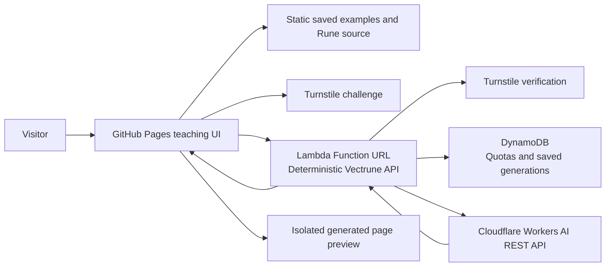

# Budget AI demo for the teaching site

Status: proposed. Updated November 4, 2026.

Keep vectrune.com on GitHub Pages and add a small Vectrune API on AWS Lambda that calls Cloudflare Workers AI. The teaching UI stays authored in Rune. The API controls models, request sizes, generation quotas and saved results. This demonstrates Vectrune as both the website language and the application backend.

A separate Cloudflare Worker is unnecessary in this design: Lambda can call the Workers AI REST API directly. A browser-only implementation would expose the account's API token and let visitors bypass its budget controls. Cloudflare's [REST API requires an account ID and API token](https://developers.cloudflare.com/workers-ai/get-started/rest-api/); keep the token on the server.

The alternative with the fewest cloud components is GitHub Pages → Cloudflare Worker → Workers AI, with a SQLite-backed Durable Object for shared quotas. It removes AWS entirely, but requires a Worker implementation or a future Vectrune Worker target. Choose that alternative if avoiding AWS billing exposure matters more than demonstrating Vectrune Lambda.

## Recommended architecture



The static gallery remains available when live generation is disabled or its daily allowance has been used. The live API uses ordinary deterministic REST handlers. AI generates page content and recommendation data; it does not decide whether a request is authorized or within budget.

Start with a fixed cafe example and a few allowed style choices. Offer a live recommendation endpoint first, then full HTML generation after model quality and token usage have been measured. Do not launch an arbitrary Rune execution service as part of this demo.

## Request and replay flow

1. The visitor selects a preset and completes Turnstile. The browser submits the preset ID, bounded customization, an idempotency key and the challenge token to `POST /demo/generate`.
2. Lambda validates the method, body size and preset. It verifies Turnstile server-side, including the expected hostname and action. A browser widget alone is insufficient; tokens are single-use and expire after five minutes. [Turnstile validation](https://developers.cloudflare.com/turnstile/get-started/server-side-validation/)
3. The API checks for an existing result or in-flight request using the idempotency key and normalized content identity. A completed replay returns without inference. An in-flight duplicate returns a retryable status rather than starting another model call.
4. Before inference, a DynamoDB transaction reserves the request's worst-case neuron allowance and increments the daily generation and visitor counters. If any limit cannot be reserved, return 429 with a retry time. If the quota store is unavailable, reject generation. [DynamoDB conditional writes](https://docs.aws.amazon.com/amazondynamodb/latest/developerguide/Expressions.ConditionExpressions.html)
5. Lambda calls one server-selected Cloudflare model with bounded input and output tokens. It validates the returned HTML or JSON and stores the result under a server-generated immutable ID.
6. The API returns the result and its ID. The teaching site displays it and offers a bookmark such as `?generation=<id>`. `GET /demo/generations/<id>` retrieves the saved result without inference.

The browser's thinking screen appears before the POST; there is no extra Lambda invocation just to deliver a waiting page. Start with synchronous requests and no automatic polling. A timeout does not automatically submit another generation. Treat expired in-flight records as uncertain: query the existing result, then require an explicit new request before spending another reservation.

Hosted `cache=off` means a new generation request through the same challenge, quota and token limits. It cannot bypass the server's controls or overwrite an immutable saved result. The local server's generation keys remain useful development behavior; the public service uses server-issued IDs to avoid global name collisions.

Saved pages contain generated HTML, not snapshots of all future API calls. A recommendation from a saved cafe still invokes the live recommendation API and consumes its own allowance. Include that endpoint in every budget counter. Recorded responses in the static gallery are labeled as recorded.

## Shared state and storage

Use one DynamoDB Standard table in provisioned capacity mode initially. Store UTC daily budgets, short-lived idempotency records, visitor counters and saved generations. Use transactional conditions for reservations and creation; a read followed by an unconditional increment is not a global limit.

Keep generated HTML below 128 KiB, including a separate check that the complete record fits DynamoDB's item limit. Cap hosted retention at 500 saved results and seven days initially. Enforce both count and expiration in application reads and writes; background TTL deletion is not an immediate expiry or capacity mechanism. Return a clear expired/not-found result for old links. Approved gallery examples can be exported to GitHub Pages for permanent viewing.

The existing memory cache is an optional optimization, not the quota authority. The local snapshot filesystem is also unsuitable for hosted persistence: Lambda's `/tmp` is ephemeral and isolated to an execution environment. Use a storage interface backed by DynamoDB for the hosted service. [Lambda ephemeral storage](https://docs.aws.amazon.com/lambda/latest/dg/configuration-ephemeral-storage.html)

## Budget controls

These are initial application settings, not promises of account-wide free usage.

| Control | Initial recommendation |
| --- | --- |
| Cloudflare account plan | Workers Free; no paid model, prepaid-credit or paid-provider fallback |
| Daily AI budget | At most 8,000 reserved neurons per UTC day, leaving headroom below the account allowance |
| Daily inference calls | At most 100, further reduced by the neuron calculation |
| Per visitor | 3 generations per day and one outstanding request; anonymous limits are abuse friction, not identity guarantees |
| AI input | Fixed preset plus small customizations; bound the complete assembled prompt |
| AI output | At most 4,000 model tokens and 128 KiB of accepted HTML; separate smaller JSON limit |
| Response target | 20 seconds, advisory |
| Provider deadline | 60 seconds; no automatic retry |
| Lambda timeout | 90 seconds, including validation and persistence |
| Lambda memory | Begin at 256 MiB; benchmark before selecting the deployment value |
| Lambda concurrency | Begin at 1 reserved concurrent invocation; return busy rather than queueing requests |
| Logs | Short retention, request IDs, elapsed time and token counts; omit prompts, tokens and request bodies |

Cloudflare currently includes 10,000 neurons per day, reset at 00:00 UTC. On the Free plan, exceeding that allocation fails requests rather than enabling paid overage. Some models require paid access, so select and benchmark a model actually available to the Free account at deployment time. [Workers AI pricing](https://developers.cloudflare.com/workers-ai/platform/pricing/)

Neuron cost depends on the model and token counts. Let `ni` and `no` be the selected model's neurons per million input and output tokens. With validated token bounds `Imax` and `Omax`, reserve:

```text
reservation = ceil((Imax × ni + Omax × no) / 1,000,000)
daily call cap = min(100, floor(8,000 / reservation))
```

Use a matching tokenizer or a validated conservative token bound; character counts are not token counts. Do not enable a model until its charging units, reasoning-token behavior and worst-case reservation have been checked. If its billing scheme differs, give it a matching estimator. Count failed or timed-out calls conservatively as spent; do not refund merely because the caller saw an error. Maintain an explicit model allowlist and stop when rate data is unavailable. Other use of the same Cloudflare account consumes the same allowance.

AWS lists 1 million Lambda requests and 400,000 GB-seconds per month in its free tier. Under an illustrative 30-day workload of 100 admitted generations per day, each using 256 MiB for the entire 90-second timeout, generation compute is `3,000 × 0.25 × 90 = 67,500 GB-seconds`. This excludes initialization, replay requests, rejected traffic and unrelated functions. Verify the personal account's eligibility and remaining allocation. [Lambda pricing](https://aws.amazon.com/lambda/pricing/)

DynamoDB lists a free allocation of 25 provisioned read and write capacity units and 25 GB of Standard storage. Start within the account's remaining provisioned allowance and measure large-item write costs; do not assume on-demand requests share that capacity allowance. [DynamoDB pricing](https://aws.amazon.com/dynamodb/pricing/)

An application quota cannot guarantee a zero AWS bill: even a quickly rejected request can invoke Lambda. Reserved concurrency limits simultaneous work, not monthly requests or spend. Billing alerts are monitoring rather than an immediate hard cap. Keep provisioned concurrency off and avoid a VPC/NAT gateway, extra public gateways and paid fallbacks for this first deployment. Account for logs, networking and storage as well as inference. [Lambda concurrency](https://docs.aws.amazon.com/lambda/latest/dg/configuration-concurrency.html)

If an absolute provider-enforced zero-overage deployment is required, prefer the Cloudflare-only Free architecture. Workers and SQLite-backed Durable Objects are available on Free plans with enforced usage limits, but the demo stops when any allowance is reached. It would require its own implementation and benchmarks. [Workers limits](https://developers.cloudflare.com/workers/platform/limits/), [Durable Objects pricing](https://developers.cloudflare.com/durable-objects/platform/pricing/)

## Credentials and browser isolation

Keep the Cloudflare API token and Turnstile secret in protected Lambda environment configuration, populated from the personal machine. Restrict the token to the relevant Cloudflare account and Workers AI permissions. The Lambda execution role can access only its table and log group. Do not put secrets into Rune source, browser code, git or deployment outputs.

Use a Lambda Function URL to avoid a separate API Gateway for the first version. A public anonymous demo requires public invocation permissions and server-side challenge verification. Configure CORS for the exact teaching-site origin and required methods; CORS is not authentication and does not stop direct callers. Local development uses a separate explicit origin configuration. A shared API key embedded in the website provides no protection. [Function URL configuration](https://docs.aws.amazon.com/lambda/latest/dg/urls-configuration.html)

Show generated HTML in an iframe with `sandbox="allow-scripts"`, without same-origin access, popups or top navigation. The teaching page brokers a narrow recommendation API through a message channel tied to that frame, generation ID and a per-frame capability. Verify the sending frame and permitted action; do not trust an opaque `null` origin by itself. Generated code receives neither provider credentials nor unrestricted access to the teaching page. The provider prompt must target this bridge rather than assuming native same-origin `/api/*` fetches work inside the isolated preview.

## Vectrune implementation work

The intended application is authored entirely in Rune using trusted runtime primitives, with a native Rust bootstrap. The required primitives are not all implemented today.

| Area | Current foundation | Required work |
| --- | --- | --- |
| Lambda entry and packaging | [Lambda runtime](../src/lambda_main/aws_lambda.rs), [packager](../src/cli/lambda.rs) | Add Function URL payload v2 support: HTTP method, raw path/query, headers/cookies, base64 bodies and response handling. Existing handler primarily reads v1 fields. |
| AI provider | [Generation adapters](../src/apps/dynamic_ai_web/engine.rs) | Add Workers AI REST support, token limits, usage parsing and server-side credential resolution. |
| Admission rules | Deterministic REST routes and native builtins | Add reusable secret-backed HTTPS calls and conditional/transactional DynamoDB operations, or narrowly scoped demo primitives. Keep quota decisions deterministic. |
| Persistence | [Local snapshots](../src/apps/dynamic_ai_web/generations.rs), [memory cache](../src/cache.rs) | Introduce shared storage for hosted quotas, immutable results and idempotency; local files and process memory cannot provide it. |
| Teaching UI | Rune components, source viewer and examples | Add challenge, generation submission, thinking state, saved links, daily-limit fallback and isolated preview/API bridge. |

Use a deterministic API application for the public gate, not an AI-backed endpoint description that asks the model to enforce limits. Do not advertise a deployable `engine = cloudflare` Rune example until its adapter and tests exist. The initial provider model and quota settings are deployment configuration, not browser parameters.

## Implementation and personal PC rollout

1. Implement the runtime gaps above locally with mock Cloudflare and DynamoDB tests. Add deployment infrastructure as code and a Rune API application in a follow-up change. This proposal creates no cloud resources.
2. On the personal PC, pull `main`. Use AWS CLI with a named personal profile and verify it with `aws sts get-caller-identity --profile vectrune-personal`. Obtain the Cloudflare account ID, scoped API token and Turnstile keys on that machine; keep them there.
3. Build a Linux binary for Lambda's selected architecture using an Amazon Linux compatible container or CI build. A Windows executable or arbitrary WSL-linked binary is not automatically Lambda-compatible. Package it with the existing Vectrune Lambda packager and the new Rune application.
4. Deploy one table, execution role, function, Function URL and short-retention log group from that PC. Select the intended region explicitly. Confirm all account free-tier allocations, Cloudflare Free status, model eligibility and absence of paid fallbacks before enabling public traffic.
5. Start with live generation disabled. Verify v2 event routing, CORS, mocked inference, durable quotas, secret omission and saved-result retrieval. Then enable a very small real allowance, measure output quality, token cost, latency and memory, and adjust the reservation estimator conservatively.
6. Configure the teaching UI with only the public endpoint and Turnstile site key. Publish the static gallery and test the isolated live preview. Raise the demo allowance only after measured usage fits the reservation model.
7. Provide an operational off switch that disables inference while preserving the static gallery. For an AWS emergency stop, disable the public Function URL or set function reserved concurrency to zero; verify the choice for the deployed endpoint. Never rely on a browser-only flag to stop spending.

Before launch, test simultaneous requests at the final available reservation, duplicate submissions, midnight rollover, cold starts, store failure, provider timeout and provider 429 responses. Prove that fresh-preview requests consume budget, saved replays do not invoke AI, expired entries are rejected before TTL cleanup, and generated scripts cannot read parent-page state. Verify shutdown and recovery from the personal PC without moving its credentials to another machine.
